# ไดอะแกรมระบบ PetCare

ไดอะแกรมทั้ง 4 ชุดเขียนด้วย **Mermaid** (ไฟล์ต้นฉบับ `.mmd` อยู่ใน `docs/diagrams/`)
และเรนเดอร์เป็น SVG (เวกเตอร์) กับ PNG (ตัวอย่าง) แล้ว
ไอคอนใช้ emoji ใน Mermaid เพื่อให้ SVG แสดงได้ทุกที่โดยไม่ต้องโหลด icon pack เพิ่ม

| แผนภาพ | ไฟล์เรนเดอร์ | ต้นฉบับ |
|---|---|---|
| Use Case | [`diagrams/use-case.svg`](diagrams/use-case.svg) | [`diagrams/use-case.mmd`](diagrams/use-case.mmd) |
| ER Diagram | [`diagrams/er-diagram.svg`](diagrams/er-diagram.svg) | [`diagrams/er-diagram.mmd`](diagrams/er-diagram.mmd) |
| CI/CD Pipeline | [`diagrams/cicd-pipeline.svg`](diagrams/cicd-pipeline.svg) | [`diagrams/cicd-pipeline.mmd`](diagrams/cicd-pipeline.mmd) |
| Load Balancer | [`diagrams/load-balancer.svg`](diagrams/load-balancer.svg) | [`diagrams/load-balancer.mmd`](diagrams/load-balancer.mmd) |

---

## 1. Use Case Diagram



**ขอบเขต:** ระบบ PetCare Clinic (กล่อง "PetCare System") มี 4 actor ภายนอก
(OWNER, VET, STAFF, DevOps) และ 1 system actor (Worker)

- **OWNER:** สมัคร/เข้าสู่ระบบ, จัดการสัตว์เลี้ยง (รวมอัปโหลด/ดู/ลบรูป),
  ดูสล็อตว่าง, จองนัด, ดูนัด/รายละเอียด, ยกเลิกนัด (ก่อนนัด ≥ 2 ชม.), ดูคิวสด,
  รับการแจ้งเตือน
- **VET:** ดูตารางงาน/เปิดเคส, บันทึกการรักษาแบบมีเวอร์ชัน, ส่งคำขอปรับเวลา,
  ดูรูปสัตว์เลี้ยง, รับการแจ้งเตือน
- **STAFF:** เปลี่ยนสถานะนัด (BOOKED → CHECKED_IN → IN_TREATMENT → COMPLETED / NO_SHOW),
  เลื่อน/สลับ/โอนเคส, อนุมัติ–ปฏิเสธคำขอปรับเวลา, จัดการกะ, สร้างบัญชี VET/STAFF,
  ดู Audit Log, ดูรูปสัตว์เลี้ยง, ยกเลิกนัดได้แม้ใกล้เวลา (กฎ 2 ชม. ใช้กับ OWNER)
- **DevOps:** deploy, monitoring, auto-recovery
- **Worker (system actor):** อ่าน outbox แล้วสร้าง notification/reminder

**ความสัมพันธ์สำคัญ**
- `จองนัดหมาย` «include» `ดูสล็อตว่างตามกะแพทย์`
- `อนุมัติคำขอปรับเวลา` → เรียก use case `เลื่อน/สลับ/โอนเคส`
- `อัปโหลด/ลบรูปสัตว์เลี้ยง` «include» `เขียน Audit Log + Outbox`
  (`PET_PHOTO_UPDATED` / `PET_PHOTO_DELETED`)
- ทุก use case ที่เปลี่ยนข้อมูล (จอง, ยกเลิก, บันทึกการรักษา, เปลี่ยนสถานะ, เลื่อน,
  จัดการกะ, อัปโหลด/ลบรูป) «include» `เขียน Audit Log + Outbox`
  ใน **transaction เดียวกัน** ตาม ADR-5/NFR-10

> หมายเหตุ: UI ของ OWNER ยังไม่มีปุ่มขอเลื่อนนัดเอง — การเลื่อนทำโดย STAFF ที่กระดานนัด
> หรือ VET ส่งคำขอให้ STAFF อนุมัติ (ตรงกับที่ implement จริง)
>
> การดูรูปต้องเสียบ Bearer token ผ่าน `GET /pets/{id}/photo`; OWNER เห็น/จัดการรูปของตัวเอง,
> STAFF และ VET ดูได้ตามสิทธิ์การเข้าถึงสัตว์เลี้ยง ส่วน light/dark mode เป็น UI preference
> ไม่ใช่ use case ทางธุรกิจ จึงไม่แสดงในแผนภาพ

---

## 2. ER Diagram



**9 ตาราง:** `users`, `pets`, `vet_shifts`, `appointments`, `reschedule_requests`,
`treatment_notes`, `outbox_events`, `notifications`, `audit_logs`

**รูปสัตว์เลี้ยง:** `pets.photo_filename` เก็บชื่อไฟล์ WebP (nullable) ที่อยู่บน named volume
`petphotos` ไม่ได้เก็บ binary ใน DB; `pets.photo_updated_at` ใช้เป็น timestamp สำหรับ
cache-busting/refetch ฝั่ง client และแสดงสถานะรูปที่ผ่านการย่อฝั่ง server
(ด้านยาวสุด ≤ 1024 px, `Cache-Control: private, max-age=60`)

**Foreign keys ที่ควรระวัง**
- `appointments` อ้าง `users` **สองครั้ง**: `owner_id` (OWNER) และ `vet_id` (VET)
  พร้อม `pet_id` และ `shift_id`
- `vet_shifts` อ้าง `users` สองครั้ง: `vet_id` และ `created_by` (STAFF)
- `reschedule_requests` อ้าง `users` สามครั้ง: `requested_by`, `reviewed_by` และ `appointment_id`
- `audit_logs.actor_id` เป็น **logical reference** ไม่มี FK (เจตนา เพื่อให้ log อยู่ได้แม้ผู้ใช้ถูกลบ)

**Constraints / Indexes ที่ไม่แสดงใน ER**
| กลไก | รายละเอียด |
|---|---|
| `uq_vet_slot_active` | UNIQUE `(vet_id, slot_start)` แบบ partial `WHERE status <> 'CANCELLED'` — กันสัตวแพทย์จองซ้ำ |
| `uq_pet_slot_active` | UNIQUE `(pet_id, slot_start)` แบบ partial — กันสัตว์ตัวเดียวถูกจองซ้อน |
| `EXCLUDE USING gist` | กันกะของสัตวแพทย์ซ้อนกัน (ต้องเปิด `btree_gist`) |
| `CHECK slot_length` | `slot_end = slot_start + interval '30 minutes'` |
| `uq_note_version` | UNIQUE `(appointment_id, version)` ของบันทึกการรักษา |
| `uq_event_recipient` | UNIQUE `(event_id, recipient_id)` ของ notification — idempotent |
| trigger | `audit_logs` เป็น append-only (UPDATE/DELETE ถูกปฏิเสธ) |
| `appointments.version` | optimistic locking สำหรับ STAFF (409 เมื่อ version ไม่ตรง) |

---

## 3. CI/CD Pipeline Architecture



ตรงกับ `Jenkinsfile` 4 stage:

1. **Checkout** — `checkout scm`, `git rev-parse --short HEAD`
2. **Build & Verify** (ทำขนานกันได้)
   - `docker compose build` + build image nginx
   - สร้าง `petcare_test` บน PostgreSQL แล้วรอ `pg_isready`
   - `ruff check app tests` → `mypy app` → `alembic upgrade head` → `pytest -q`
   - Gitleaks สแกน secret ด้วย `.gitleaks.toml`
3. **Deploy** — `docker compose up -d --remove-orphans` (project `petcare-ci`)
4. **Post-Deployment Verification** — `scripts/seed` + `scripts/post_deploy_check.sh`
   ตรวจ health live/ready, login, availability, Prometheus targets และไม่มี 5xx

**Secrets:** `petcare-jwt-secret`, `petcare-postgres-password`, `petcare-grafana-password`
อ่านจาก Jenkins credentials เท่านั้น ไม่เก็บใน repo
**เมื่อไม่ผ่าน:** pipeline หยุด, เก็บ log (`docker compose logs --tail=80 ...`) และ rollback
ตาม `docs/runbook.md`

---

## 4. Load Balancer Architecture



- **Edge:** nginx :80 เสิร์ฟ React SPA และ reverse proxy `/api/*`
  - upstream `web1:8000` + `web2:8000` แบบ **round-robin**
  - `max_fails=2 fail_timeout=10s`, `proxy_next_upstream` (tries 2), `proxy_connect_timeout 3s`
  - **ไม่ใช้ upstream keepalive** เพื่อให้แต่ละ request กระจายสลับ instance ได้จริง
  - rate limit เฉพาะ `/api/v1/auth/login` (30 r/m, burst 10)
  - ปิด `/metrics` จากภายนอก (404)
- **App tier:** FastAPI 2 ตัว **stateless**, JWT 60 นาที + Argon2id
  จึงไม่ต้องมี sticky session; ทุก instance ตอบด้วยข้อมูลจาก DB
- **Data tier:** PostgreSQL 16 + named volume `pgdata`
- **Shared photo storage:** `web1` และ `web2` mount named volume `petphotos` ที่ `/data/pet-photos`
  (ใช้ร่วมกันทั้งสอง instance) โดย DB เก็บเฉพาะ `photo_filename`; อัปโหลดจำกัด 8 MB, nginx รับ body ≤ 10 MB,
  server ย่อ/แปลงเป็น WebP และเสิร์ฟผ่าน API ที่ต้อง authenticate — ไม่เปิด static path
  ของรูปโดยตรง
- **Async:** worker ดึง outbox ด้วย `FOR UPDATE SKIP LOCKED`; `migrate` เป็น one-shot
- **Observability:** Prometheus scrape `web1`, `web2`, node-exporter, cAdvisor;
  Grafana ใช้ Prometheus เป็น datasource
- **Self-healing:** `autoheal` restart container ที่ unhealthy (label `autoheal=true`)
- ตรวจว่าโหลดกระจายจริง: ดู header `X-Instance-Id` จาก `/api/v1/health/live`

---

## 5. แก้ไขและเรนเดอร์ใหม่

แก้ไฟล์ `.mmd` แล้วรัน (ต้องมี Chromium/Puppeteer สำหรับ Mermaid CLI):

```bash
# SVG สำหรับ docs
npx -y @mermaid-js/mermaid-cli@11 \
  -i docs/diagrams/load-balancer.mmd \
  -o docs/diagrams/load-balancer.svg \
  -b white -w 2400

# PNG preview (ความกว้างปรับตามชนิดแผนภาพ)
npx -y @mermaid-js/mermaid-cli@11 \
  -i docs/diagrams/load-balancer.mmd \
  -o docs/diagrams/preview/load-balancer.png \
  -b white -w 2000
```

หาก Chromium ถูกจัดการโดย Playwright แล้ว สามารถชี้ executable ได้:

```bash
CHROME=$(cd frontend && node -e "console.log(require('playwright').chromium.executablePath())")
node -e "require('fs').writeFileSync('/tmp/pptr.json', JSON.stringify({executablePath: process.argv[1]}))" "$CHROME"
PUPPETEER_SKIP_DOWNLOAD=1 npx -y @mermaid-js/mermaid-cli@11 \
  -p /tmp/pptr.json -i docs/diagrams/er-diagram.mmd \
  -o docs/diagrams/er-diagram.svg -b white -w 2400
```

## 6. ไฟล์อ้างอิงที่ใช้ตรวจความถูกต้อง

- `docker-compose.yml`, `nginx/nginx.conf` → Load Balancer
- `backend/app/models/*.py`, `backend/alembic/versions/0001_initial.py`,
  `backend/alembic/versions/0002_pet_photos.py` → ER
- `backend/app/api/v1/pets.py`, `backend/app/services/pet_photo_service.py` → use case รูปสัตว์เลี้ยง
- `docker-compose.yml` (`petphotos` volume), `nginx/nginx.conf` (`client_max_body_size 10m`)
  → Load Balancer
- `Jenkinsfile`, `scripts/post_deploy_check.sh` → CI/CD
- `Detailed Technical Implementation Masterplan.md` → use case/ขอบเขต
- `docs/manual-testing.md` → ขั้นตอนทดสอบด้วยมนุษย์
